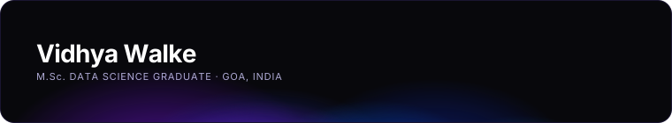

***

# Vidhya Walke

A Data Science enthusiast & Full Stack Developer passionate about Pythonic programming, applied AI, and building clean web applications. M.Sc. Data Science graduate from Goa Business School, Goa University.

- 🔭 **Currently working on:** RAG applications, semantic search systems, and reactive web apps.
- 🌱 **Learning & exploring:** Deep neural networks, LLM workflows, and modern recommendation architectures.
- 👯 **Looking to collaborate on:** Data science, machine learning, and open-source software projects.
- 💬 **Ask me about:** Python, Machine Learning, RAG, React, FastAPI, or SQL.
- ⚡ **Fun facts:** Passionate [bibliophile](https://en.wikipedia.org/wiki/Bibliophilia) — and you know you're a programmer when you spend hours tracking down a bug and fix it with one line of code!

---

### Featured Projects

- [**RAG PDF Knowledge Assistant**](https://github.com/vidhyawalke/rag-pdf-knowledge-assistant) — Semantic search and grounded Q&A over PDFs using FAISS and Google Gemini. `Python` `FastAPI` `FAISS` `LangChain`
- [**CO–PO Assessment Tool**](https://github.com/vidhyawalke/co-po-mapper) — Curriculum mapping web app calculating NAAC-compliant accreditation attainment matrices. `React` `Zustand` `TailwindCSS`
- [**Customer Segmentation App**](https://github.com/vidhyawalke/customer-segmentations-kmeans-app) — Real-time KMeans customer clustering app with demographic breakdowns. `Python` `Streamlit` `Scikit-Learn`
- [**Spam Email Classifier**](https://github.com/vidhyawalke/spam-email-classification) — Comparative NLP email spam detection comparing classical ML and LSTM. `Python` `Streamlit` `Deep Learning`
- [**Goodreads Book Scraper**](https://github.com/vidhyawalke/goodreads-web-scraping) — Automated data extraction pipeline crawling and parsing multi-page book catalogs. `Python` `Selenium` `BeautifulSoup`

---

### Tech Stack

- **Languages:** Python, SQL, JavaScript (ES6+), HTML5, CSS3, R
- **Data Science & AI:** Machine Learning, RAG, Deep Learning (ANN/LSTM), NLP, FAISS, Scikit-Learn, PyCaret, Pandas, NumPy
- **Web & Backend:** React, Node.js, FastAPI, Flask, Streamlit, Tailwind CSS
- **Tools & Platforms:** Git, GitHub, Tableau, Docker, Jupyter Notebook

---

### Connect

Feel free to explore my repositories, open an issue, or reach out:

[Portfolio](https://vidhya-walke-portfolio.vercel.app/) · [LinkedIn](https://www.linkedin.com/in/vidhyawalke) · [GitHub](https://github.com/vidhyawalke) · [Kaggle](https://www.kaggle.com/vidhyawalke) · [LeetCode](https://leetcode.com/u/vidhyawalke/) · [Email](mailto:vidhya.walke.official@gmail.com)
